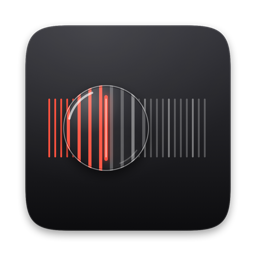
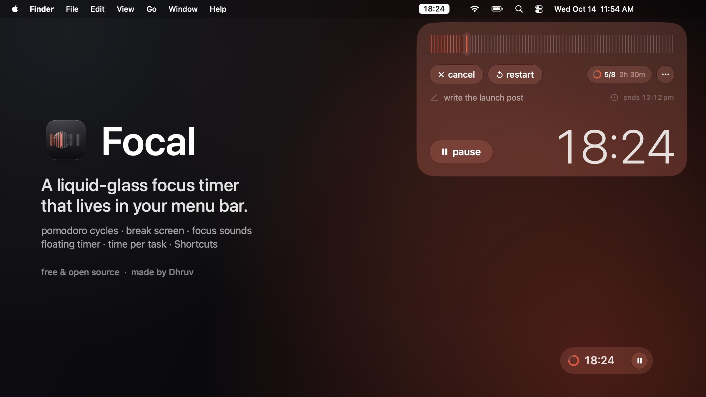
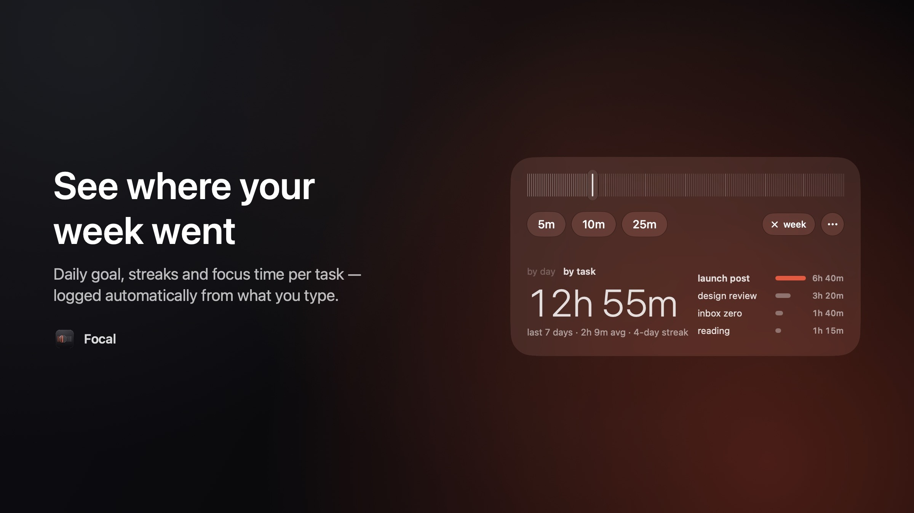
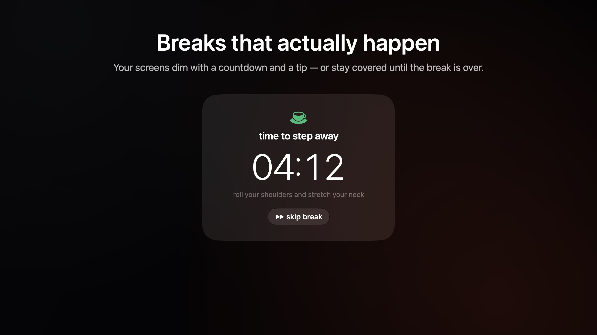
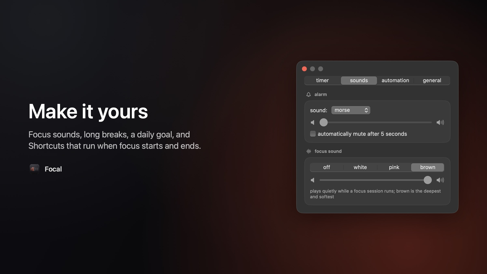

<p align="center">
  
</p>

<h1 align="center">Focal</h1>

<p align="center">
  A liquid-glass focus timer that lives in your Mac's menu bar.<br>
  <a href="https://github.com/Dhruv6896/focal/releases/latest"><b>Download for macOS</b></a> · Apple Silicon · free & open source
</p>



Click the pill in your menu bar and a Liquid Glass panel drops down: drag the tick ruler to any
length, hit start, and get back to work. Focal handles the Pomodoro rhythm around you — breaks,
long breaks, a daily goal — and keeps out of the way the rest of the time.

## Features

- **Menu bar timer.** A pill shows the time left; a cup appears during breaks. Compact ring style available.
- **Liquid Glass panel** on macOS 26+: glass buttons that morph between states, a glass lens on the ruler, rolling digits.
- **Pomodoro cycles.** Breaks, a long break every few sessions, optional autopilot from one to the next.
- **Floating timer.** A small glass pill that stays on top — even over full-screen apps and video calls.
- **Break screen.** Your displays dim with a countdown and a tip — or stay covered until the break is over.
- **Time per task.** Type what you're working on; the week view shows where the time went, plus your streak and daily goal.
- **Focus sounds.** White, pink or brown noise that plays only while you're focusing.
- **Shortcuts automation.** Run any Shortcut when focus starts and ends — e.g. turn Do Not Disturb on and off.
- **Keyboard-first.** ⌥⌘P from anywhere; space, arrows, 1/2/3 and more inside the panel.
- **Survives restarts.** A running timer picks up where it left off after quitting, updating or rebooting.







## Install

1. Download **Focal-1.0.dmg** from the [latest release](https://github.com/Dhruv6896/focal/releases/latest).
2. Open it and drag **Focal** into **Applications**.
3. Focal isn't notarized by Apple yet, so macOS blocks the first launch. Open **System Settings → Privacy & Security**,
   scroll down and click **Open Anyway** (one time only).

Requires an Apple Silicon Mac with macOS 13 or later. The Liquid Glass look needs macOS 26 or later; older versions get a
clean solid style.

## Using it

- Click the pill in the menu bar (or press **⌥⌘P** anywhere) to open the timer. Right-click it for a quick menu.
- Drag across the tick strip, scroll over the panel, or click a preset. Brighter ticks mark every 15 minutes.
- In the panel: **space** start/pause · **← →** ±1 min (**⇧** ±5) · **1 2 3** presets · **w** week view ·
  **f** floating timer · **return** dismiss · **esc** close · **⌘,** settings · **⌘Q** quit.
- Type what you're working on under the presets; the clock button brings back recent tasks.
- Settings has four tabs: timer (lengths, long breaks, daily goal, break screen), sounds, automation and general.

## Build from source

Only the Xcode Command Line Tools are needed.

```bash
./scripts/build.sh            # → build/Focal.app
./scripts/build.sh --install  # also copies it to /Applications and launches it
./scripts/make_dmg.sh         # → build/Focal-1.0.dmg
```

The app icon is drawn by `scripts/make_icon.swift` and the installer background by
`scripts/make_dmg_background.swift`.

### Development

- `./scripts/preview.sh [--settings]` opens the panel in an ordinary window (debug build, its own settings).
- `./scripts/preview.sh --app` runs the whole app that way, including the floating timer and break screen.
- `./scripts/preview.sh --showcase hero|week|break|settings --wallpaper <png>` renders the README images;
  `scripts/showcase/` has the wallpaper and stitching helpers.

## Feedback

Bug reports and ideas are welcome — [open an issue](https://github.com/Dhruv6896/focal/issues).

## License

[MIT](LICENSE). Made by Dhruv.
